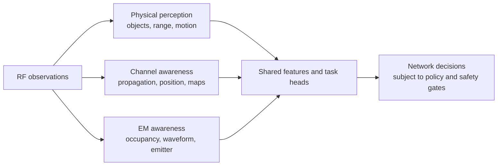

# AI-Based Spectrum Sensing and RF Sensing

## The Objective

An AI-based spectrum sensing and sharing framework that uses real-time radio observations to detect interference, classify signals, and support adaptive network control. By enabling real-time spectrum awareness and intelligent control, the framework helps networks improve spectrum utilization, adapt to changing RF conditions, and support more reliable wireless performance. The system can also identify previously unseen signal types, expanding spectrum awareness beyond traditional approaches.

## Purpose and source

This guide provides an expanded, implementation-oriented synthesis of the linked survey, including its mathematical foundations, passive-object sensing, spectrum/emitter analysis, datasets, and integration challenges. It deliberately summarizes and reorganizes the ideas rather than reproducing the paper's prose, tables, or illustrations. Diagrams below are original conceptual diagrams. The starter code in this repository is a small, reproducible example, not a validated implementation of the survey's experimental methods.

**Source:** V. Shatov et al., “Integrated Radio Sensing Capabilities for 6G Networks: AI/ML Perspective,” *IEEE Communications Surveys & Tutorials*, vol. 28, pp. 5081–5120, 2026, [doi:10.1109/COMST.2026.3668458](https://doi.org/10.1109/COMST.2026.3668458). The paper asks readers to cite the version of record. Source PDF: [`references/AI:ML Perspective of Radio Sensing.pdf`](https://github.com/rajibdash/Distributed-multisensor-ISAC/blob/main/references/AI%3AML%20Perspective%20of%20Radio%20Sensing.pdf).

**Traceability:** the reviewed [PDF revision](https://github.com/rajibdash/Distributed-multisensor-ISAC/blob/970b2a5f657891cf57c06e9f65c2d74c35d15a5f/references/AI%3AML%20Perspective%20of%20Radio%20Sensing.pdf) has 39 PDF pages, including a repository cover sheet. Page references below use **PDF page numbers**, not journal pagination: article page 1 is PDF page 2. References such as “survey ref. [174]” identify entries in the paper's bibliography, not references independently reproduced or revalidated here. Section 15 maps the survey's substantive sections to this guide. Numerical study results are reported with their limitations; they are not results of this repository.

**Reading paths:** sections 1–4 introduce the common foundations; sections 5–9 describe the original starter architecture and engineering recommendations; sections 10–14 expand the survey's radar, spectrum, localization, dataset, and integration material. The guide is a technical synthesis, not a verbatim extraction or a substitute for the complete literature review.

## 1. What “radio sensing” covers ?

Radio sensing is broader than radar. The current survey from the document connects three related functions that can share RF hardware, data pipelines, and learning techniques:

| Domain | What is inferred | Example tasks |
|---|---|---|
| Physical perception (radar-like) | Properties and motion of passive objects illuminated by a transmitter | Detection, range/angle/Doppler estimation, orientation/shape inference, tracking, gesture and environmental sensing |
| Channel and propagation sensing | How the propagation environment affects radio links | Channel estimation/sounding, environment characterization, localization and channel charting |
| Electromagnetic/spectrum awareness | Which emitters and waveforms are present, where they are, and how spectrum is occupied | Occupancy detection, signal/modulation classification, anomaly/jammer detection, emitter localization |

The first two often use cooperating transmitters and receivers; emitter analysis is frequently passive and non-cooperative. Integrated sensing and communication (ISAC) makes these functions part of a shared network rather than isolated instruments. The broader ambition is an RF view of the environment that can support communication adaptation, planning, interference management, and security.

## 2. Signal and task models

### 2.1 Received baseband signal

A useful narrowband complex-baseband model for a receiver is

$$
 x[n] = \sum_{k=1}^{K} a_k h_k[n] s_k[n] e^{j(2\pi \Delta f_k n/F_s + \phi_k)} + w[n],
$$

where `s_k` is an emitter waveform, `a_k` captures path loss, `h_k` captures fading/multipath, `Δf_k` is residual frequency offset, `φ_k` is phase, `F_s` is sample rate, and `w[n]` is receiver noise. In practice, quantization, AGC, oscillator error, antenna response, synchronization, bandwidth limits, and interference also shape the observation. The model is an abstraction, not a replacement for a measured RF-chain model.

### 2.2 Occupancy as a hypothesis test

For one channel or one time-frequency bin, the basic decision is

$$
\mathcal H_0: x[n]=w[n], \qquad
\mathcal H_1: x[n]=s[n]+w[n].
$$

A detector computes a statistic `T(x)` and compares it with a threshold `γ`: declare occupied when `T(x) > γ`. A simple energy statistic is

$$
T_E(x)=\frac{1}{N}\sum_{n=0}^{N-1}|x[n]|^2.
$$

Under ideal complex Gaussian noise with known noise power `σ_w²`, the normalized energy is related to a chi-square statistic. A threshold can therefore be selected for a target false-alarm probability, or learned/calibrated empirically from representative noise-only captures. Noise uncertainty and non-stationary interference are important practical weaknesses of energy detection. This repository's CNN does **not** solve calibration or guarantee a desired false-alarm rate.

For a wideband receiver, use a windowed representation such as per-bin power/PSD and produce an occupancy vector `y_b ∈ {0,1}` over frequency bins. Temporal aggregation can reduce flicker, but adds decision delay and can miss short bursts.

### 2.3 Learning objectives

The same observation can support a hierarchy of outputs:

1. **Detection:** occupied/unoccupied or object absent/present.
2. **Classification:** signal family, modulation, protocol, emitter type, or anomaly class.
3. **Estimation:** continuous quantities such as SNR, angle, range, Doppler, or channel parameters.
4. **Localization/tracking:** position and identity/trajectory over time.
5. **Decision-making:** when to sense, which band to inspect, or whether to propose an access opportunity.

Do not conflate an occupancy classifier with emitter identification, authorized-user identification, or a permission to transmit. Those require different data, validation, and policy controls.

### 2.4 Multipath, bandwidth, and antenna-array structure

**Survey II-A, PDF pp. 7–8.** Unlike the narrowband abstraction above, a time-varying multipath model explicitly retains delay:

$$
y(t)=\int h(t,\tau)s(t-\tau)\,d\tau+w(t),\qquad
h(t,\tau)=\sum_{\ell=0}^{L(t)-1}
\alpha_\ell(t)\delta(\tau-\tau_\ell(t))e^{-j2\pi f_{D,\ell}t}.
$$

This uses the conventional delay-domain convolution notation. The Doppler sign depends on the chosen baseband convention. Each path has a complex gain, delay, and Doppler; reflection, scattering, and diffraction produce a superposition rather than a single object measurement. In the survey's underspread-channel approximation, `B_D τ_rms << 1`, with Doppler spread `B_D` and RMS delay spread `τ_rms`. Radar calls the delay coordinate **fast time** and the observation-to-observation evolution **slow time**.

Sampling at `F_s = 1/T_s` does not make all physical paths resolvable. Paths closer than the effective delay resolution combine in a measured tap; occupied bandwidth and the measurement window also limit resolution. A quasi-static approximation is appropriate only over an interval short enough relative to channel coherence time.

For an array, geometric delay and phase differences encode direction. A standard narrowband far-field uniform linear array (ULA) model is

$$
\mathbf Y=\mathbf A(\boldsymbol\theta)\mathbf S+\mathbf N,\qquad
[\mathbf a(\theta)]_i=e^{-j2\pi i d\sin(\theta)/\lambda},
\quad i=0,\ldots,K-1.
$$

Here `K` is the antenna count, `d` is spacing, `λ` is wavelength, columns of `A` are steering vectors, and columns of `Y` are temporal snapshots. This model assumes appropriate calibration and a suitable wavefront approximation. Near-field, wideband, mutual-coupling, gain/phase, and position errors require richer models. An array supplies angular information; a single link can supply delay/Doppler information, but does not generally determine an arbitrary position without additional geometry or constraints.

## 3. Metrics and evaluation

For occupancy detection, report the confusion matrix and at least:

$$
P_D = P(\widehat{\mathcal H}=\mathcal H_1\mid\mathcal H_1),\quad
P_{FA}=P(\widehat{\mathcal H}=\mathcal H_1\mid\mathcal H_0),\quad
P_M=1-P_D.
$$

Plot the ROC or `P_D` against SNR at a fixed `P_FA`; also report precision/recall when class prevalence is skewed. For operational use, include calibration error, per-band and per-device performance, inference latency, energy use, missed-burst behavior, and confidence intervals. Separate data by capture session/site/device/time to avoid leakage from adjacent windows. Randomly splitting overlapping windows can make results misleadingly optimistic.

For estimation/localization, use task-specific error such as MSE/RMSE and compare with physical/statistical lower bounds where appropriate. Multi-object detection and localization can require a metric that jointly accounts for missed/false targets and localization error (for example GOSPA). Report detection probability and false alarms alongside errors; no single accuracy number is sufficient.

### 3.1 Estimation bounds and set-valued errors

**Survey II-B and IV-C, PDF pp. 8, 26.** For a parameter vector, `MSE = E[||θ_hat - θ||²]`. Under the regularity and unbiasedness assumptions of the classical Cramer-Rao bound (CRB),

$$
\operatorname{Cov}(\widehat{\boldsymbol\theta})
\succeq \mathbf I(\boldsymbol\theta)^{-1},\qquad
I_{ij}=-\mathbb E\!\left[
\frac{\partial^2\log p(\mathbf y;\boldsymbol\theta)}
{\partial\theta_i\partial\theta_j}\right].
$$

The likelihood, noise, geometry, and nuisance parameters define the bound. A learned estimator can be biased through regularization or prior information, so the ordinary unbiased CRB is **not** a universal minimum MSE for every neural estimator. A comparison is meaningful only under compatible assumptions.

GOSPA evaluates sets rather than preassigned target indices. For true and estimated sets `P` and `P_hat`, with cardinalities `m <= n`, one form is

$$
d_{\mathrm{GOSPA}}=
\left[
\min_{\pi}\sum_{i=1}^{m}
\min\!\left(\|\mathbf p_i-\widehat{\mathbf p}_{\pi(i)}\|,c\right)^p
+\frac{c^p}{\alpha}(n-m)
\right]^{1/p},
\quad c>0,\quad p\ge1,\quad 0<\alpha\le2.
$$

Exchange the sets when `m > n`; `π` selects distinct assignments. The cut-off `c` caps localization cost, `p` controls emphasis on large errors, and `α` controls cardinality penalties. This avoids reporting a small position RMSE while ignoring missed or extra targets. The same principle applies to multiple emitters.

## 4. Methods: domain knowledge and machine learning

### 4.1 Classical signal processing

- Energy detection is simple and inexpensive but sensitive to uncertain noise floors and weak signals.
- Matched filtering can be powerful when a known reference waveform is available, but assumes cooperation and synchronization.
- Cyclostationary/statistical features exploit modulation structure and can distinguish some signals from noise, at additional compute and observation cost.
- Periodograms/Welch PSDs, autocorrelation, higher-order statistics, and model-based estimators provide interpretable feature baselines.
- For spatial/radar tasks, array processing, beamforming, MUSIC/related subspace methods, FFT-based range-Doppler processing, and Bayesian tracking are useful reference points.

### 4.2 Data-driven approaches

Learning can use engineered features, raw I/Q, spectrograms, channel impulse/frequency responses, range-Doppler maps, or fused multimodal inputs. CNNs can exploit local structure in I/Q or time-frequency images; recurrent/attention models can model longer sequences; metric-learning embeddings can support channel charts; multi-task networks can share a representation among occupancy, classification, and estimation heads. Classical DSP can also be retained as a front end or unrolled into a trainable model to preserve structure and reduce data demands.

Important design choices include label granularity, signal families and bandwidths, train/test domain separation, window length, and whether the model sees absolute amplitude, normalized samples, or derived features. Normalization can improve invariance but may remove useful power evidence. Always compare against a simple detector and ablations; a larger neural network is not automatically better.

### 4.3 Cooperative sensing

Multiple receivers can combine local decisions, features, or raw observations to improve coverage and mitigate local fading. Fusion may be centralized or distributed. The choice trades bandwidth, synchronization, latency, privacy exposure, and robustness to faulty or malicious nodes. Record sensor identity and timing; validate that fusion still works with missing, delayed, or miscalibrated sensors.

### 4.4 Adjacent radio-sensing tasks

- **Emitter classification/anomaly detection:** supervised classifiers need representative labels; novelty detection can help when unknown signals are expected, but does not identify an anomaly's cause.
- **Transmitter localization:** cooperative positioning can use time/angle measurements; non-cooperative approaches exploit received signal features and geometry. Synchronization and propagation uncertainty affect accuracy.
- **Channel charting:** self-supervised embeddings of channel measurements aim to preserve neighborhood relationships without requiring dense ground-truth positions. The learned chart is generally a relative map, not automatically a metric coordinate system.
- **Radar sensing:** detection, range/angle/Doppler estimation, tracking, gestures, and environmental/material inference bring distinct labels and metrics. Communication and sensing objectives can conflict over power, waveform, and time/frequency resources.
- **Multi-task and multimodal learning:** shared models may combine sensing modalities and reduce duplicated processing, but task interference, missing modalities, privacy, and failure coupling must be measured.

### 4.5 Learning paradigms, objectives, and representations

**Survey II-C, PDF pp. 8–10.** Supervised learning needs task labels; self-supervised learning derives training signals from the observations themselves; unsupervised learning seeks structure without task labels. Reinforcement learning (RL) learns actions from rewards and environment interactions, rather than from independent labeled windows. The advisory agents in section 6 are **not** trained RL agents.

For a batch of `B` examples, common objectives are

$$
\mathcal L_{\mathrm{reg}}=\frac1B\sum_i\|\mathbf y_i-\widehat{\mathbf y}_i\|^2,\quad
\mathcal L_{\mathrm{class}}=-\frac1B\sum_i\sum_c t_{ic}\log p_{ic},
$$

$$
\mathcal L_{\mathrm{binary}}=-\frac1B\sum_i
\left[t_i\log p_i+(1-t_i)\log(1-p_i)\right].
$$

Regression estimates continuous parameters; categorical cross-entropy handles mutually exclusive classes; binary objectives can be used per bin for occupancy. Independent per-bin outputs are a multi-label task, not necessarily a single softmax over the whole band. Training uses mini-batches and gradient-based updates where the model is differentiable. Optimizer choice, model capacity, and stopping criteria do not remove overfitting or guarantee a global optimum.

Representation determines which information is available:

| Representation | Useful structure | Important cost or limitation |
|---|---|---|
| Raw complex IQ, usually stacked real/imaginary channels | Amplitude, phase, waveform and RF-chain effects | High input and transport volume; device-specific shortcuts are possible |
| Amplitude/phase or constellation views | Modulation structure | Phase wrapping, synchronization, and representation-specific information loss |
| PSD or magnitude spectrogram | Spectral occupancy and time-frequency shape | Magnitude representations discard phase; STFT adds processing cost |
| CSI, CIR, or channel frequency response | Propagation, delay, array and spatial structure | Requires channel estimation, commonly from pilots or a known transmit sequence |
| Covariance, autocorrelation, or engineered statistics | Compact spatial/statistical evidence | May discard distinctions needed for a more difficult task |
| Range-Doppler/angle maps and point clouds | Physical-target structure | Resolution, preprocessing assumptions, clutter, and sparsity matter |

CNNs exploit local patterns; recurrent networks and transformers exploit sequence dependence; graph neural networks (GNNs) model relationships between sensors, users, or interference links. Complex-valued networks can process complex signals natively, although the survey notes limited adoption and framework support at the time of writing. Architecture names alone do not establish superiority.

### 4.6 Data generation and the simulation-to-measurement gap

**Survey II-C, PDF pp. 9–10.** Standardized stochastic channel models and tools such as **QuaDRiGa** support controlled communication-channel experiments. Deterministic target location and environmental geometry often call for ray tracing instead: the survey discusses **Sionna RT** and **Remcom Wireless InSite**, with **DeepMIMO** as a scenario-organized dataset resource. Full electromagnetic simulation is more expensive; ray tracing is a practical approximation, not a complete RF measurement.

Geometry, material calibration, hardware distortion, interference, mobility, and weather affect transfer to the field. Measurement-based calibration can improve ray tracing, but over-the-air measurements remain necessary to validate real performance. CSI-only datasets reduce storage and can support testing different waveforms under an appropriate linear channel model; they cannot establish all waveform-dependent RF-chain or end-to-end effects.

### 4.7 Complexity reduction is part of the sensing design

**Survey II-D, PDF pp. 10–11.** Compare training cost separately from repeated inference cost. **Model-based learning (MBL)** makes selected parameters or blocks of a conventional algorithm trainable, retaining useful physical structure. **Deep unfolding** turns a bounded number of iterations into trainable stages. Examples include learnable calibration, improved covariance estimation, and neural initialization followed by a conventional estimator. Ordinary backpropagation requires a differentiable path through the trained components.

These approaches can reduce trainable parameters, data requirements, or runtime in studied scenarios; they are not guarantees for every task. The survey also discusses **spiking neural networks**, which encode discrete events and may save energy on neuromorphic hardware. Such savings depend on encoding, event activity, and hardware implementation, not just replacing a layer name.

## 5. Original reference architecture

```mermaid
flowchart LR
  A[RF front end / IQ capture] --> B[Timestamp, calibration, quality checks]
  B --> C[Windowing / PSD / feature extraction]
  C --> D[Detector and classifier models]
  D --> E[Occupancy and confidence estimates]
  E --> F[Policy agent: protect / resense / candidate]
  F --> G[Human or network policy gate]
  G --> H[Authorized downstream controller]
  I[Telemetry, labels, drift checks] --> J[Dataset and experiment registry]
  J --> K[Offline train, evaluate, approve]
  K --> D
  H --> I
```

The code here implements only a synthetic single-link detector, a CNN inference wrapper, and a non-actuating policy recommendation. It does not implement RF capture, multi-band sensing, cooperative fusion, a scheduler, regulatory checks, or closed-loop control.

## 6. Agents in this starter

`SpectrumSensingAgent` wraps a trained model and converts one `2 × N` I/Q window into an occupied probability. `SpectrumPolicyAgent` maps that score to one of three advisory outcomes:

- **protect:** occupancy probability is high; do not treat the band as available;
- **resense:** the score is ambiguous; acquire another observation or consult a stronger detector;
- **access_candidate:** probability is low, so the band may be reviewed by a separate authorization process.

The last outcome is deliberately not “transmit.” In a real deployment, the policy agent must be subordinate to licensing/regulatory rules, incumbent protection, hardware health checks, and any human approval requirement. Agents must fail closed on missing, stale, out-of-range, or low-quality observations. The starter returns a proposal only and must not control a radio.

## 7. ML lifecycle / MLOps

1. **Define the contract:** specify band, bandwidth, sampling, window length, label semantics, allowable latency, target `P_FA`/`P_D`, and operating domains.
2. **Acquire and govern data:** record device/antenna, gain, location/time, calibration, bandwidth, labels, permissions, and provenance. Minimize retained raw IQ and apply access/retention controls.
3. **Validate data:** check clipping, DC offsets, sample-rate mismatch, missing windows, label quality, class balance, and site/device leakage.
4. **Version experiments:** pin code, dependencies, data manifest/hash, seed, preprocessing, model parameters, and evaluation split. Store artifacts with metadata and a model card.
5. **Evaluate before release:** test fixed-`P_FA` performance, SNR sweeps, unseen devices/sites, signal mixtures, interference, robustness, calibration, latency, and resource use. Compare to energy/cyclostationary baselines.
6. **Deploy in shadow mode:** run beside an incumbent detector; log outcomes and delayed labels without affecting transmission decisions.
7. **Monitor and rollback:** track score distributions, input quality, drift, false alarms, misses, latency, and hardware changes. Require re-validation/approval for retraining or threshold changes.

Federated or edge training can reduce raw-data movement, but does not eliminate privacy risk; model updates, metadata, and the sensing process itself can still leak information. Adversarial examples and intentional RF interference require threat models and robustness testing, not only ordinary random augmentation.

## 8. Limitations and practical risks

- **Data scarcity and labels:** real RF captures are expensive, sensitive, and difficult to label exhaustively; simulations can omit important propagation and RF-chain effects.
- **Domain shift:** device, antenna, site, season, bandwidth, gain, protocol, and receiver settings can alter distributions. Validate on held-out domains.
- **Open-world signals:** a closed-set classifier may assign an unknown waveform to a known class with high confidence. Preserve an unknown/abstain path.
- **False alarms and missed detections:** costs are asymmetric and context-specific. Pick thresholds from an explicit risk and policy target rather than maximizing accuracy.
- **Latency, synchronization, compute and power:** wideband capture and distributed processing can be constrained by front-end bandwidth, sampling, edge compute, and transport.
- **Privacy and security:** radio measurements can reveal device presence and behavior. Secure storage/transport, access control, minimization, and adversarial testing are part of the design.
- **Explainability and governance:** expose evidence/quality and keep logs; a score is not a causal explanation or authorization.

## 9. Starter baseline and next steps

The included generator creates complex noise-only windows and occupied windows containing randomized QPSK-like signals with phase, carrier offset, fading, and a sampled SNR. The compact CNN sees separate I and Q channels. This controlled task is useful for wiring up the ML lifecycle, not for estimating field performance; its signal family and channel are intentionally limited.

Recommended increments:

1. Add an energy detector and measure `P_D` at fixed `P_FA` over SNR and sample-count sweeps.
2. Add multiple modulations, pulse shaping, frequency-selective channels, adjacent-channel interference, real RF impairments, and measured captures.
3. Add wideband PSD inputs with multi-label per-bin output, plus signal classification as a distinct task.
4. Add cooperative observations with asynchronous/missing-sensor tests and privacy-aware feature fusion.
5. Add MLflow or an equivalent experiment registry, DVC/object-store data manifests, model cards, staged deployment, and drift dashboards once there is real governed data.
6. Compare CNN against calibrated DSP and hybrid/model-based baselines on unseen sessions, receivers, and sites.

## 10. Passive-object sensing: radar processing and learning

**Survey III, PDF pp. 11–19.** “Passive objects” means the targets need not transmit. It does **not** mean the sensing system has no illuminator. ISAC may use dedicated sensing resources, reuse communication signals, or jointly design a shared waveform. Monostatic, bistatic, and multistatic geometries have different synchronization, calibration, clutter, and localization requirements.

### 10.1 Two communication-sensing trade-offs

**Survey III-A, PDF pp. 11–13.** The **deterministic/randomness trade-off** concerns transmit-symbol statistics: communication needs information-bearing variation, while constant-power symbols can favor sensing. The **subspace/power trade-off** concerns allocating beam directions, power, bandwidth, and time to communication and sensing. It is not simply a choice of one classifier threshold.

One illustrative joint objective from the survey combines communication bit loss, target-detection loss, and angular estimation error:

$$
\mathcal L=(1-w_s)\mathcal L_{\mathrm{comm,BCE}}
+w_s\left(\mathcal L_{\mathrm{detect,BCE}}+\mathcal L_{\mathrm{angle,MSE}}\right).
$$

The weight `w_s` selects an operating preference; practical implementations also need compatible loss scaling and explicit constraints. Learned beam patterns can illuminate a sensing sector while maintaining service to users. RL can select resource allocations; GNNs can represent inter-user/inter-vehicle interference and cooperation. EIRP, sidelobe, service-quality, and other transmission constraints remain part of the optimization.

**Geometric constellation shaping** changes symbol locations; **probabilistic shaping** changes symbol probabilities. The survey describes sensing-favoring, near-constant-modulus versus communication-favoring constellations, and reports analysis linking constellation kurtosis to OFDM sensing performance. This is a waveform-design result under the studied model, not a universal claim that QAM or PSK is always preferable. Neither shaping nor learned allocation closes every gap to theoretical bounds.

### 10.2 From OFDM measurements to range-Doppler detection

**Survey III-B, PDF pp. 13–14.** Let `X` and `R` contain transmitted and received frequency-domain symbols, with subcarriers along rows and successive symbols along columns. After cyclic-prefix removal and OFDM demodulation, a simple channel estimate on known nonzero symbols is `H_hat = R ⊘ X`. A conventional map is

$$
\mathrm{RDM}=
\left|\operatorname{DFT}_{\mathrm{slow\ time}}
\left(\operatorname{IDFT}_{\mathrm{subcarriers}}(\widehat{\mathbf H})\right)\right|^2.
$$

The inverse transform maps frequency to delay; the transform across symbols maps slow time to Doppler. Null subcarriers, low-amplitude pilots, noise enhancement, windowing, and synchronization need explicit treatment rather than unconditional division. A peak is initially a delay/Doppler cell, not automatically a unique physical object. For monostatic round-trip geometry, `r = cτ/2` and radial-speed magnitude is `λ|f_D|/2`; bistatic measurements instead constrain total path length and a geometry-dependent Doppler projection.

With known complex Gaussian noise power, a normalized squared-magnitude statistic can use a chi-square quantile to meet a specified false-alarm probability. **Cell-averaging CFAR** and **ordered-statistics CFAR** estimate the local background from training cells around a cell under test, with guard cells to reduce target leakage. Their false-alarm control depends on the background assumptions.

Nearby or extended targets contaminate training cells; clutter, sidelobes, ghost paths, colored noise, and calibration errors can create false detections. Micro-Doppler or extended scattering can produce several detections from one object. Learned detectors can exploit map structure or jointly classify target types, including features lost after peak extraction. Improvements reported against CFAR or an “optimal” detector are conditional on scenario information and statistical assumptions; they do not overturn Neyman-Pearson optimality for its specified hypotheses.

### 10.3 Parameter estimation in one to four dimensions

**Survey III-C, PDF pp. 14–17.** Detection asks whether a target exists; estimation refines its parameters. A grid-based network predicts target probabilities at candidate locations, but has grid-resolution and output-size costs. Continuous regression avoids a fixed output grid, yet must handle unknown target count and permutation/association of target outputs. Joint detection and regression can combine both approaches.

| Estimation task | Conventional reference methods | Learning opportunities discussed in the survey |
|---|---|---|
| AoA | MUSIC/root-MUSIC, ESPRIT, maximum likelihood, compressive sensing | Learn an angular spectrum, denoise covariance, augment subspace processing, or calibrate array gains/positions |
| Delay/range and Doppler | RDM peaks, subspace methods, iterative likelihood estimation | Initialize a likelihood search with a neural estimate; infer parameters from maps; investigate synthetic-to-measured transfer |
| Angle and range | Joint antenna/frequency processing | Learn array-position impairment compensation, including pseudo-label-based calibration |
| Delay, Doppler, azimuth, elevation | Multidimensional likelihood/subspace processing | Joint 4D detection/estimation and hybrid neural/likelihood refinement with lower runtime in studied scenarios |

For AoA, a useful compact input is the sample covariance `R_Y = YYᴴ/T`, where `T` is the snapshot count. Hermitian symmetry avoids storing duplicate entries. Low SNR, few snapshots, coherent sources, broadband operation, and array mismatch stress different algorithms; the survey's Table III compares which of these conditions individual studies address. No single method there solves all practical array problems.

Classical iterative estimators such as **RIMAX** can approach model-based bounds at substantial computational cost. Joint estimation across more dimensions can separate targets that overlap in one projection, but increases memory and computation. Choosing a lower-dimensional approximation is therefore a deployment decision, not just an accuracy preference.

### 10.4 Tracking and predictive beamforming

**Survey III-D, PDF pp. 17–18.** Tracking combines observations over time and manages object identity, new/disappearing trajectories, and clutter. Data association drives much of multi-object tracking complexity; independent per-frame position regression does not solve it.

The survey discusses probability-hypothesis-density, generalized labeled multi-Bernoulli, and trajectory Poisson multi-Bernoulli mixture methods, alongside Kalman and particle-filter families. A Kalman filter is MMSE-optimal under a correctly specified linear-Gaussian state-space model; extended/unscented filters approximate nonlinear problems, while particle filters support nonlinear/non-Gaussian settings with additional computation. Model mismatch degrades these methods.

Learned Kalman/particle-filter components can compensate for some mismatch and estimate uncertainty. Transformers can infer target count and trajectories; LSTMs can support predictive beamforming from sequential observations. **Smoothing**, which can use later observations, must be distinguished from causal online tracking when reporting latency or accuracy.

### 10.5 Gesture, environmental, and distributed sensing

**Survey III-E–III-G, PDF pp. 18–19.** Gesture/posture recognition exploits temporal radar signatures and range-Doppler features rather than only target coordinates. RF sensing does not need visible light or a worn sensor, but that does not make its classifications universally reliable. The survey covers synthetic-data studies, mmWave-access-point experiments, and 4D imaging-radar posture classification.

Environmental sensing estimates material properties or particle distributions, not just geometry. Examples include weather classification with **MeteoNet**, rain-fade prediction from imagery and link measurements, THz material sensing, and learning reflectivity/material parameters to calibrate a digital twin. The necessary spatial/material detail remains an open modeling choice.

Distributed physical sensing combines multistatic links or coordinated multi-sensor MIMO observations. Local detection, estimation, or feature/confidence extraction reduces signaling versus forwarding every raw sample. Fusion may be classical confidence-weighted processing, learned joint estimation, or multimodal processing with cameras/LiDAR. Heterogeneous links and bands must be aligned with the actual fusion model. The survey emphasizes specialized learned blocks and hybrid pipelines; it does not establish a single universal replacement for the whole sensing chain.

## 11. Spectrum and emitter analysis in more detail

### 11.1 Wideband occupancy and cooperative observation

**Survey IV-A, PDF pp. 19–21.** A wideband receiver forms observations over `N_f` sub-bands and decides occupancy separately. In the Wiener-Khinchin view, PSD is the Fourier transform of autocorrelation; finite-sample PSD estimates are noisy and their resolution depends on observation length and processing. The output is an occupancy map, not a single class for the entire band.

Single-user sensing has low coordination overhead but is exposed to local fading and hidden nodes. Cooperative spectrum sensing adds spatial diversity through raw-data, feature, or decision fusion. The survey discusses CNN-LSTM processing of spatial/temporal correlations, unsupervised PCA-based representations with pseudo-labels, and sub-band-specific networks for **partial observations**, where each receiver sees only a subset of the full band. Unobserved bins must not be interpreted as measured-free bins.

Transformers can use both intra-band and inter-band relationships. GAN-based augmentation can expand scarce labeled training data, but its realism and generalization need independent validation. Choosing a threshold of `0.5` for a probability output does not establish a desired `P_FA`; threshold calibration must use representative validation data.

### 11.2 Sensing-throughput trade-off is not the radar waveform trade-off

**Survey IV-A3, PDF pp. 20–21.** For a shared radio that senses for `τ` within a frame of length `T`, only `T - τ` remains for payload. Longer observation can improve reliability but reduces available transmission time. An illustrative engineering abstraction is

$$
R_{\mathrm{effective}}(\tau)=\frac{T-\tau}{T}\,
R_{\mathrm{payload}}\,P(\text{usable access decision};\tau).
$$

This is not a complete throughput law: traffic, incumbents, interference, detection errors, and access rules must be modeled. Passive spectrum observation has no transmit-waveform design trade-off of its own, unlike radar ISAC. Dedicated continuously sensing nodes can remove the local sense-then-transmit time split, but still consume energy, backhaul/control resources, and fusion time. Sensing-node scheduling can therefore remain an optimization problem.

### 11.3 Modulation classification versus waveform/RAT recognition

**Survey IV-B, PDF pp. 21–24.** Automatic modulation classification (AMC) identifies a modulation such as QPSK or QAM. Waveform/radio-access-technology (RAT) recognition distinguishes technologies or signal structures. LTE, NR, and Wi-Fi can share OFDM and similar modulations; recognizing QAM does not identify a protocol, device, authorized user, or malicious intent. Fully integrated sensing/communication waveforms may strongly resemble their communication-only or radar-only ancestors.

For a closed set of classes, a classifier selects `argmax_c p(H_c | x, Θ)`; a practical system additionally needs noise/absence and unknown/abstain handling. Likelihood-based classification can be costly and needs signal models. Feature-based classification uses statistics with decision trees, random forests, SVMs, or small neural networks. Example higher-order moments are

$$
M_{pq}=\mathbb E[x^{p-q}(x^*)^q].
$$

Combinations yield higher-order cumulants; amplitude, instantaneous phase/frequency, and cyclostationary statistics provide other features. Their ability to distinguish classes depends on the candidate signals. The survey contrasts relatively separable low-order modulations with overlapping feature distributions for more diverse communications/radar waveforms.

Feature selection reduces redundant computation. For discrete distributions on a common support, the **Bhattacharyya distance**

$$
D_B(P,Q)=-\ln\sum_x\sqrt{P(x)Q(x)}
$$

measures overlap: zero for identical distributions and larger values for greater separation. It can guide selection, but does not itself guarantee a robust multiclass classifier.

Raw-IQ or amplitude/phase networks retain richer evidence at higher dimensionality. CNNs, recurrent models, transformers, and hybrid expert-feature/raw-input models explore this trade-off. Spectrogram methods convert signal recognition into image detection, including YOLO-style time-frequency localization followed by refinement. STFT window, hop/overlap, and window function affect representation and preprocessing cost; magnitude-only spectrograms lose phase. Report capture, preprocessing, transfer, and inference latency together, rather than timing only the neural layers.

### 11.4 Anomalies and cooperative classification

**Survey IV-B4–IV-B5, PDF pp. 23–24.** Anomaly detection can learn normal behavior without enumerating every unwanted waveform. The survey includes autoencoder-based methods and digital-twin/radio-environment-map comparisons between expected and measured distributed RSS. A deviation may indicate a new transmitter, but can also reflect an environmental or equipment change; it is not proof of a jammer.

Cooperative classification can fuse local class probabilities/votes, engineered features, averaged FFT magnitudes, or raw observations. Centralized models may gain information but demand more bandwidth and compute; distributed models can send compact summaries. Sensor weighting, unequal SNR, and calibration matter: poor fusion can be worse than one good receiver. Additional sensors alone do not guarantee improvement.

### 11.5 Interpreting representative study results

**Survey IV-A–IV-B and Table IV, PDF pp. 20–25.** These examples show feasibility under particular setups, not a cross-paper leaderboard:

| Survey reference | Reported observation | Qualification needed before reuse |
|---|---|---|
| [167], DeepSweep | Under 1 ms inference and up to 98% accuracy | Narrowband Wi-Fi/interference setting in the 2.4 GHz band; not validation of arbitrary wideband occupancy |
| [174], cooperative CNN-LSTM | Approximately 1.3 ms inference | Reported with an NVIDIA Quadro P5000 GPU; hardware and processing scope matter |
| [168], transformer detector | Better accuracy and reduced complexity against its selected CNN baseline | The survey calls for over-the-air validation |
| [192], IQ/amplitude-phase AMC | High-accuracy OFDM classification | Table IV reports inference above 1 s, limiting real-time use |
| [202], low-cost distributed classification | Roughly 80% or higher depending on model configuration | Small waveform set; averaged spectral magnitudes and model size constrain conclusions |

The survey also flags high inference cost for partial-observation cooperative sensing [176], missing latency analysis in some spectrogram studies, and limited class diversity in several cooperative AMC studies. Accuracy, SNR, waveform set, data provenance, hardware, and latency scope differ, so their numbers are not directly comparable.

## 12. Transmitter localization, multi-task learning, and channel charting

### 12.1 Blind and coherent positioning are different cooperation assumptions

**Survey IV-C, PDF pp. 25–27.** **Blind/non-cooperative positioning** means the emitter does not provide positioning-specific assistance. The observing sensors can still cooperate with each other and a central unit. AoA needs array information; RSS can be obtained with simpler receivers but depends strongly on propagation and transmit-power assumptions.

An illustrative RSS model in dB is

$$
P_j=P_0-10\beta\log_{10}(d_j/d_0)+n_j,
$$

where `P_0` is received power at reference distance `d_0`, `β` is the path-loss exponent, and `n_j` is Gaussian shadowing in the dB domain. The model implies lognormal power fluctuations in linear units. It is primarily a coverage model; walls, NLoS paths, unknown power, and model mismatch can make inversion for position unreliable. Neural RSS fingerprints or image-like CSI/RSS representations can learn site-specific nonlinear relationships, but require held-out-site and changed-environment evaluation.

With appropriately synchronized sensors, coherent processing can retain cross-sensor information. The survey's **position information correlation matrix (PICM)** uses diagonal entries for per-sensor power and off-diagonal entries for inter-sensor correlation. This can retain spatial information discarded by RSS alone. Compact features reduce dimensionality and training cost, but can lose useful position evidence.

Noncooperative-emitter operation, receiver cooperation, clock alignment, and carrier-phase coherence are separate properties. Federated training does not make unsynchronized raw signals coherent; timestamp correction or synchronization-insensitive features must match the intended inference method.

### 12.2 Joint classification and localization

**Survey IV-D, PDF pp. 27–28.** A shared backbone can feed a waveform-classification head and a coordinate-regression head. A supervised sample has both label types, for example `{multisensor IQ, waveform class, x_TX, y_TX}`. One reported composite objective is

$$
\mathcal L_{\mathrm{total}}=
\mathcal L_{\mathrm{position,MSE}}+
\lambda\mathcal L_{\mathrm{waveform,CE}}.
$$

`λ` balances losses with potentially very different scales. Related tasks can share computation and sometimes improve representation learning, but task interference and per-head performance still need measurement. Survey ref. [227] uses stacked 256-sample I/Q observations with a shared recurrent/fully connected network; it is a separate research architecture, **not** the CNN implemented here.

Adding a noise/absence class can extend classification toward occupancy detection. Localization of a nonexistent emitter must then be masked or marked not applicable rather than treated as a valid coordinate. Multi-emitter localization requires additional output-count and association design.

The survey also describes self-supervised deep clustering of FFT sequences [225]. The system learns features and groups without signal-type labels, but attaching names such as LTE, NR, Wi-Fi, or noise still requires a semantic mapping step. “Label-free training” does not mean that class identities emerge with verified names automatically.

### 12.3 How channel charting learns relative geometry

**Survey IV-E, PDF p. 28.** Supervised fingerprinting needs reference positions. **Channel charting** learns a low-dimensional chart from high-dimensional CSI without dense absolute-location labels. It assumes sufficiently stable, location-informative channels; changes in environment or hardware can invalidate the learned mapping.

A forward charting function `z_i = C_Θ(f_i)` maps channel features to chart coordinates. Dissimilarities can use angle-delay profiles and timestamp-based neighborhood information. Triplet networks share weights across an anchor, a nearby/similar example, and a dissimilar example; Siamese networks share weights across pairs. Typical illustrative objectives are

$$
\mathcal L_{\mathrm{triplet}}=
\max(0,\|\mathbf z_i-\mathbf z_j\|^2-\|\mathbf z_i-\mathbf z_k\|^2+m),
$$

$$
\mathcal L_{\mathrm{pair}}=
\left(\|\mathbf z_i-\mathbf z_j\|-d_{ij}\right)^2,
$$

where `m > 0` is a margin and `d_ij` is a channel-derived dissimilarity. These are examples of the learning principles, not a claim that every cited study uses these exact losses. Pairwise distance matching depends especially on the quality/scale of `d_ij`; triplet learning emphasizes relative ordering.

The survey illustrates recovery of an L-shaped topology using a DICHASUS measurement collection, including NLoS regions. This demonstrates a particular dataset and method, not general absolute positioning. Without alignment/calibration or suitable constraints, chart axes, rotation, scale, and global geometry are not guaranteed to match physical coordinates. Relative charts can nevertheless inform mobility-aware resource assignment, tracking, and beam management.

## 13. Dataset and benchmark selection

**Survey II-C, III-H, IV-B7, IV-E and Table V, PDF pp. 9–10, 19, 24–26, 28.** Dataset names below identify resources discussed by the survey. This is a task/provenance guide, not a reproduction of Table V. No dataset is downloaded, bundled, or endorsed as production-ready by this repository.

| Resource / survey reference | What it enables | Main qualification |
|---|---|---|
| QuaDRiGa [62], DeepMIMO [65], Sionna RT [63] | Controlled channel generation or scenario-based channel data | Simulated channels are not measurements of all receiver impairments |
| RadioML 2018.01A [212] | Established IQ modulation-classification baseline with 24 classes | Known issues and legacy signal coverage; inspect the exact release and generation/capture procedure |
| RML22 [213] | Modulation dataset and reproducible Python generation framework | More controlled generation does not establish coverage of arbitrary sites, devices, or protocols |
| Wideband signal recognition dataset [214] | Time-frequency detection/localization of composed emissions | Synthetic overlapping narrowband layouts, not field-wideband validation |
| RF frame spectrogram dataset [215] | Wi-Fi/Bluetooth frame detection with generation tools | Synthetic images and limited technology diversity |
| CBRS coexistence dataset [216] | Measured LTE/pulsed-radar coexistence in 3.55–3.7 GHz | Specific waveforms/band and capture setup; not universal ISAC classification |
| ISAC UAV measurements [95] | Target/emitter localization and distributed sensing experiments | Measured 3.75 GHz scenario with 100 MHz bandwidth; application-specific |
| DeepSense [157] | Measured multimodal RF/vision/LiDAR/radar research | Sensor alignment and scenario constraints matter; distinct from the spectrum-detector method also named DeepSense [169] |
| DISC [158] | Measured 60 GHz CIR-based human detection/activity research | Channel-level representation and specific indoor conditions |
| Sensiverse [159] | Large-scale simulated ISAC/CIR and scene studies | Synthetic scene/material assumptions and substantial storage requirements |
| DICHASUS [232] | Measured CSI for channel charting and related spatial learning | Preserve antenna, timing, trajectory, and environment metadata |
| MeteoNet [149] | Weather-oriented radar/data-fusion experiments | Different labels and objectives from spectrum occupancy |

The source's discussion and Table V do not describe RadioML capture provenance identically. Do not equate every RadioML-related experiment with the same over-the-air dataset; verify the selected artifact's documentation. The survey explicitly warns about known issues and real-product use of the legacy benchmark.

Reported dataset sizes and class counts are release-specific. Inspect label definitions, SNR/channel generation, overlapping windows, licenses, and capture-device identity before choosing a split. Preserve grouping by session/site/device; do not infer generalization from a random split of near-duplicate frames.

The survey identifies two broad gaps: old AMC benchmarks do not represent the diversity of emerging ISAC/RAT waveforms, and there is no universal measured benchmark for comparing all physical-sensing methods. Distributed datasets additionally need sensor geometry, synchronization/clock metadata, partial-coverage information, and shared event labels. Synthetic data is useful for prototyping and controlled ablations; measured held-out data remains necessary for deployment claims.

## 14. Integrating sensing modalities into a network

### 14.1 What the combined system is intended to add

**Survey I-A and V-A, PDF pp. 3–4, 29–30.** A smart-factory example combines obstacle perception with interference observation: radar detects a moving object, spectrum analysis detects a transmission, and localization helps determine whether they correspond. Physical and electromagnetic awareness provide complementary evidence; either alone leaves ambiguities.

**Multimodal multi-task learning (MM-MTL)** shares information across modalities and outputs. A network could adapt the number of IQ samples, choose raw versus engineered features, or prioritize sensing links according to signal quality and required accuracy. Cameras, LiDAR, and GPS can complement RF, including when RF is degraded; radio is not always the stronger modality.

The proposed **self-sustaining network** uses sensing to maintain service KPIs: detect blockers for beam management, identify idle spectrum, characterize interference, and refine position-aware services. A physical-and-EM **digital twin** is an intermediate representation supporting such decisions. These are research/architecture opportunities, not capabilities implemented or proven by the starter.

### 14.2 RF hardware and end-to-end timing

**Survey V-B1, PDF pp. 30–31.** The envisioned pipeline uses multi-band RF frontends, wideband ADC/DAC and FPGA/baseband processing, high-rate links, and edge/cloud acceleration. Instantaneous bandwidth, sampling dynamic range, RF amplification, antenna geometry, synchronization, and calibration constrain what any learning model can recover.

Dynamic metasurface antennas can reconfigure receive/radiation patterns and other electromagnetic properties; the survey discusses a 60 GHz prototype, holographic MIMO concepts, and movable/6D-movable/pinching antennas. These are hardware research directions, not software-only features. The Open6GHub testbed is an example of a multi-band platform for evaluating communications and sensing algorithms.

For a deployment, budget total observation-to-decision delay, for example

$$
t_{\mathrm{decision}}=
t_{\mathrm{capture}}+t_{\mathrm{preprocess}}+t_{\mathrm{transport}}+
t_{\mathrm{queue}}+t_{\mathrm{inference}}+t_{\mathrm{fusion}}.
$$

This decomposition is an engineering checklist; overlap/pipelining can change the critical path. GPU/TPU speedups do not remove RF acquisition, transport, or queuing costs. Report throughput, tail latency, memory, energy, and cost for the actual hardware and load.

The survey's standardization and frequency-range discussion is historical context, not a current deployment specification. It discusses 3GPP AI/ML work, ISAC standardization, the less mature spectrum-characterization effort, and proposed additional frequency ranges. Its introductory FR2 range and later architecture illustration use different upper limits; consult the applicable standard/version rather than treating a conceptual figure as a normative band definition.

### 14.3 Distributed architecture, learning, and privacy

**Survey V-B2, PDF pp. 31–32.** The survey considers heterogeneous opportunistic devices, dedicated high-performance sensing modules, or a mixture. Blockage, coverage, receiver failure, signaling overhead, multiple access, and compute placement motivate distributed designs.

Edge inference keeps processing close to observations but has limited memory, power, and model capacity. Cloud inference allows larger shared models but introduces network dependence, delay, and raw-data exposure. Compression and local feature extraction reduce signaling at an information cost. Scheduling must consider both useful sensing contributions and link/compute resources.

GNNs can model node relationships with appropriate permutation-invariant/equivariant operations; temporal models can exploit observation histories. Neither model class automatically corrects timestamps, coherence, or missing sensor metadata.

Federated learning exchanges model updates instead of raw observations. Client/device selection and imperfect aggregation matter, particularly with heterogeneous data or radio links. FL reduces some raw-data movement but does not guarantee confidentiality or eliminate physical privacy risks. **Data privacy** concerns stored/transmitted observations and features; **physical privacy** concerns what sensing reveals about presence, motion, or activity even when everything stays on-device.

RL can adapt sensing schedules, resource allocation, and protocol decisions, but exploration can take time, degrade service, or create unsafe actions. Distributed multi-agent RL and combined FL/RL are studied approaches, not a reason to bypass policy gates. Offline validation, constrained actions, and deployment approval remain necessary engineering safeguards.

### 14.4 Robustness and foundation models

**Survey V-B3–V-B4, PDF pp. 32–33.** Robustness work must distinguish ordinary noise/domain shift from intentional perturbation of IQ, time-frequency features, CIR, or radar maps. The survey discusses adversarial training, consistency checks against plausible propagation/motion, and adaptive defensive processing. Random phase/noise augmentation alone is not evidence of resistance to a deliberate adversary. Evaluate detection, classification, localization, and false-alarm behavior under the stated threat model without assuming one defense generalizes.

Large telecom/foundation models aim to learn reusable representations from diverse IQ, spectrogram, CIR, temporal, and spatial data. The survey cites self-supervised localization models supporting ToA/AoA and localization tasks [269], and joint wireless-technology recognition/localization from IQ and CIR sequences [270]. Large diverse data, transfer evaluation, interpretability, adaptation cost, and low-latency execution remain unresolved issues. This direction coexists with the survey's expectation of specialized hybrid blocks; a universal real-time sensing model is not an established result.

## 15. Source coverage and evidence boundaries

This index maps the survey's substantive topics, including those absent from the earlier short overview. “Covered” means synthesized here, not reproduced in full or implemented. The source remains authoritative for individual studies, assumptions, derivations, figures, and its complete bibliography.

| Survey location | PDF pages | Coverage in this guide |
|---|---|---|
| I-A–I-C: motivation, related work, organization; Fig. 1 and Table I | 2–6 | Purpose, section 1, sections 14.1–14.2; taxonomy and rationale, not a copied survey-comparison table |
| II-A: band-limited channel and array models | 7–8 | Sections 2.1 and 2.4 |
| II-B: detection, false alarms, MSE, GOSPA, CRB | 8 | Sections 3 and 3.1 |
| II-C: learning, objectives, representations, channel/data generation | 8–10 | Sections 4.2, 4.5–4.6 |
| II-D: complexity, MBL, unfolding, spiking networks | 10–11 | Section 4.7 |
| III-A: communication-sensing trade-offs | 11–13 | Section 10.1 |
| III-B: range-Doppler detection and CFAR | 13–14 | Section 10.2 |
| III-C1–III-C4 and Table III: AoA, range-Doppler, angle-range, 4D estimation | 14–17 | Sections 2.4 and 10.3 |
| III-D: tracking | 17–18 | Section 10.4 |
| III-E–III-G: gestures, environment, distributed sensing | 18–19 | Sections 4.3 and 10.5 |
| III-H–III-I: datasets and lessons | 19 | Sections 10.5 and 13 |
| IV-A1–IV-A3: single/cooperative sensing and throughput trade-off | 19–21 | Sections 2.2, 11.1–11.2 |
| IV-B1–IV-B3: feature, raw-data and spectrogram classification | 21–23 | Sections 4.5 and 11.3 |
| IV-B4–IV-B6: anomalies, cooperation, signal scenarios | 23–24 | Sections 11.3–11.4 |
| IV-B7 and Tables IV–V: datasets and study limitations | 24–26 | Sections 11.5 and 13 |
| IV-C1–IV-C2: blind/coherent transmitter positioning | 25–27 | Sections 3.1 and 12.1 |
| IV-D: multi-task spectrum analysis | 27–28 | Section 12.2 |
| IV-E: channel charting | 28 | Section 12.3 |
| IV-F: passive-sensing lessons | 29 | Sections 11–13 and their evidence/scale caveats |
| V-A1–V-A3: security, representation, self-sustaining networks | 29–30 | Section 14.1 |
| V-B1–V-B2: hardware and architecture | 30–32 | Sections 14.2–14.3 |
| V-B3–V-B4: adversarial robustness and foundation models | 32–33 | Section 14.4 |
| VI: conclusions | 33 | Sections 8, 13–14; real-time, data, generalization, and integration limits |
| References | 33–39 | Source citation above; numbered study locators throughout, not a duplicated bibliography |

**Evidence boundaries:** sections 5–9 are the repository's original architecture, lifecycle guidance, and roadmap, not a claim that the survey supplies this code. Additional equations explicitly described as illustrative/conventional clarify the synthesis rather than reproducing the source's exact notation. Reported benchmark outcomes are conditional literature observations. None establishes a safe autonomous controller, universal classifier, or field-validated localization system.

## References and attribution

The primary reference is the Shatov et al. survey cited at the top. Consult its version of record for the full derivations, literature review, experimental assumptions, figures, tables, and bibliography. The page locators refer to the pinned repository PDF, whose cover sheet shifts page numbering by one.

Useful entry points in that bibliography are O'Shea and Hoydis on physical-layer deep learning [6]; Studer et al. on channel charting [229]; Sathyanarayanan et al. on RML22 [213]; Tassie et al. on measured CBRS coexistence [216]; Shatov et al. on dual-task spectrum monitoring [227]; and Euchner et al. on the distributed channel sounder used for CSI research [232]. These are study locators, not claims that their implementations or datasets are included here.
