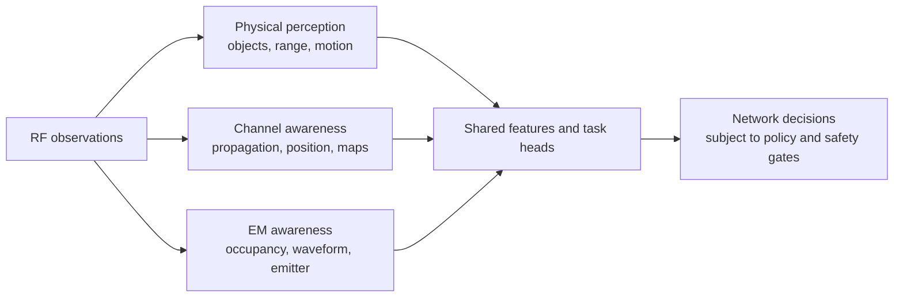

# AI-Based Spectrum Sensing and RF Sensing

## Purpose and source

This guide distills the main technical themes of the linked survey into an implementation-oriented overview. It deliberately summarizes and reorganizes the ideas rather than reproducing the paper's prose, tables, or illustrations. Diagrams below are original conceptual diagrams. The starter code in this repository is a small, reproducible example, not a validated implementation of the survey's experimental methods.

**Source:** V. Shatov et al., “Integrated Radio Sensing Capabilities for 6G Networks: AI/ML Perspective,” *IEEE Communications Surveys & Tutorials*, vol. 28, pp. 5081–5120, 2026, [doi:10.1109/COMST.2026.3668458](https://doi.org/10.1109/COMST.2026.3668458). The paper asks readers to cite the version of record. Source PDF: [`references/AI:ML Perspective of Radio Sensing.pdf`](https://github.com/rajibdash/Distributed-multisensor-ISAC/blob/main/references/AI%3AML%20Perspective%20of%20Radio%20Sensing.pdf).

## 1. What “radio sensing” covers

Radio sensing is broader than radar. The survey connects three related functions that can share RF hardware, data pipelines, and learning techniques:

| Domain | What is inferred | Example tasks |
|---|---|---|
| Physical perception (radar-like) | Properties and motion of passive objects illuminated by a transmitter | Detection, range/angle/Doppler estimation, tracking, gesture and environmental sensing |
| Channel and propagation sensing | How the propagation environment affects radio links | Channel estimation/sounding, environment characterization, localization and channel charting |
| Electromagnetic/spectrum awareness | Which emitters and waveforms are present, where they are, and how spectrum is occupied | Occupancy detection, signal/modulation classification, anomaly/jammer detection, emitter localization |

The first two often use cooperating transmitters and receivers; emitter analysis is frequently passive and non-cooperative. Integrated sensing and communication (ISAC) makes these functions part of a shared network rather than isolated instruments. The broader ambition is an RF view of the environment that can support communication adaptation, planning, interference management, and security.

## 2. Signal and task models

### 2.1 Received baseband signal

A useful narrowband complex-baseband model for a receiver is

\[
 x[n] = \sum_{k=1}^{K} a_k h_k[n] s_k[n] e^{j(2\pi \Delta f_k n/F_s + \phi_k)} + w[n],
\]

where `s_k` is an emitter waveform, `a_k` captures path loss, `h_k` captures fading/multipath, `Δf_k` is residual frequency offset, `φ_k` is phase, `F_s` is sample rate, and `w[n]` is receiver noise. In practice, quantization, AGC, oscillator error, antenna response, synchronization, bandwidth limits, and interference also shape the observation. The model is an abstraction, not a replacement for a measured RF-chain model.

### 2.2 Occupancy as a hypothesis test

For one channel or one time-frequency bin, the basic decision is

\[
\mathcal H_0: x[n]=w[n], \qquad
\mathcal H_1: x[n]=s[n]+w[n].
\]

A detector computes a statistic `T(x)` and compares it with a threshold `γ`: declare occupied when `T(x) > γ`. A simple energy statistic is

\[
T_E(x)=\frac{1}{N}\sum_{n=0}^{N-1}|x[n]|^2.
\]

Under ideal complex Gaussian noise with known noise power `σ_w²`, the normalized energy is related to a chi-square statistic. A threshold can therefore be selected for a target false-alarm probability, or learned/calibrated empirically from representative noise-only captures. Noise uncertainty and non-stationary interference are important practical weaknesses of energy detection. This repository's CNN does **not** solve calibration or guarantee a desired false-alarm rate.

For a wideband receiver, use a windowed representation such as per-bin power/PSD and produce an occupancy vector `y_b ∈ {0,1}` over frequency bins. Temporal aggregation can reduce flicker, but adds decision delay and can miss short bursts.

### 2.3 Learning objectives

The same observation can support a hierarchy of outputs:

1. **Detection:** occupied/unoccupied or object absent/present.
2. **Classification:** signal family, modulation, protocol, emitter type, or anomaly class.
3. **Estimation:** continuous quantities such as SNR, angle, range, Doppler, or channel parameters.
4. **Localization/tracking:** position and identity/trajectory over time.
5. **Decision-making:** when to sense, which band to inspect, or whether to propose an access opportunity.

Do not conflate an occupancy classifier with emitter identification, authorized-user identification, or a permission to transmit. Those require different data, validation, and policy controls.

## 3. Metrics and evaluation

For occupancy detection, report the confusion matrix and at least:

\[
P_D = P(\widehat{\mathcal H}=\mathcal H_1\mid\mathcal H_1),\quad
P_{FA}=P(\widehat{\mathcal H}=\mathcal H_1\mid\mathcal H_0),\quad
P_M=1-P_D.
\]

Plot the ROC or `P_D` against SNR at a fixed `P_FA`; also report precision/recall when class prevalence is skewed. For operational use, include calibration error, per-band and per-device performance, inference latency, energy use, missed-burst behavior, and confidence intervals. Separate data by capture session/site/device/time to avoid leakage from adjacent windows. Randomly splitting overlapping windows can make results misleadingly optimistic.

For estimation/localization, use task-specific error such as MSE/RMSE and compare with physical/statistical lower bounds where appropriate. Multi-object detection and localization can require a metric that jointly accounts for missed/false targets and localization error (for example GOSPA). Report detection probability and false alarms alongside errors; no single accuracy number is sufficient.

## 4. Methods: domain knowledge and machine learning

### 4.1 Classical signal processing

- Energy detection is simple and inexpensive but sensitive to uncertain noise floors and weak signals.
- Matched filtering can be powerful when a known reference waveform is available, but assumes cooperation and synchronization.
- Cyclostationary/statistical features exploit modulation structure and can distinguish some signals from noise, at additional compute and observation cost.
- Periodograms/Welch PSDs, autocorrelation, higher-order statistics, and model-based estimators provide interpretable feature baselines.
- For spatial/radar tasks, array processing, beamforming, MUSIC/related subspace methods, FFT-based range-Doppler processing, and Bayesian tracking are useful reference points.

### 4.2 Data-driven approaches

Learning can use engineered features, raw I/Q, spectrograms, channel impulse/frequency responses, range-Doppler maps, or fused multimodal inputs. CNNs can exploit local structure in I/Q or time-frequency images; recurrent/attention models can model longer sequences; metric-learning embeddings can support channel charts; multi-task networks can share a representation among occupancy, classification, and estimation heads. Classical DSP can also be retained as a front end or unrolled into a trainable model to preserve structure and reduce data demands.

Important design choices include label granularity, signal families and bandwidths, train/test domain separation, window length, and whether the model sees absolute amplitude, normalized samples, or derived features. Normalization can improve invariance but may remove useful power evidence. Always compare against a simple detector and ablations; a larger neural network is not automatically better.

### 4.3 Cooperative sensing

Multiple receivers can combine local decisions, features, or raw observations to improve coverage and mitigate local fading. Fusion may be centralized or distributed. The choice trades bandwidth, synchronization, latency, privacy exposure, and robustness to faulty or malicious nodes. Record sensor identity and timing; validate that fusion still works with missing, delayed, or miscalibrated sensors.

### 4.4 Adjacent radio-sensing tasks

- **Emitter classification/anomaly detection:** supervised classifiers need representative labels; novelty detection can help when unknown signals are expected, but does not identify an anomaly's cause.
- **Transmitter localization:** cooperative positioning can use time/angle measurements; non-cooperative approaches exploit received signal features and geometry. Synchronization and propagation uncertainty affect accuracy.
- **Channel charting:** self-supervised embeddings of channel measurements aim to preserve neighborhood relationships without requiring dense ground-truth positions. The learned chart is generally a relative map, not automatically a metric coordinate system.
- **Radar sensing:** detection, range/angle/Doppler estimation, tracking, gestures, and environmental/material inference bring distinct labels and metrics. Communication and sensing objectives can conflict over power, waveform, and time/frequency resources.
- **Multi-task and multimodal learning:** shared models may combine sensing modalities and reduce duplicated processing, but task interference, missing modalities, privacy, and failure coupling must be measured.

## 5. Original reference architecture

```mermaid
flowchart LR
  A[RF front end / IQ capture] --> B[Timestamp, calibration, quality checks]
  B --> C[Windowing / PSD / feature extraction]
  C --> D[Detector and classifier models]
  D --> E[Occupancy and confidence estimates]
  E --> F[Policy agent: protect / resense / candidate]
  F --> G[Human or network policy gate]
  G --> H[Authorized downstream controller]
  I[Telemetry, labels, drift checks] --> J[Dataset and experiment registry]
  J --> K[Offline train, evaluate, approve]
  K --> D
  H --> I
```

The code here implements only a synthetic single-link detector, a CNN inference wrapper, and a non-actuating policy recommendation. It does not implement RF capture, multi-band sensing, cooperative fusion, a scheduler, regulatory checks, or closed-loop control.

## 6. Agents in this starter

`SpectrumSensingAgent` wraps a trained model and converts one `2 × N` I/Q window into an occupied probability. `SpectrumPolicyAgent` maps that score to one of three advisory outcomes:

- **protect:** occupancy probability is high; do not treat the band as available;
- **resense:** the score is ambiguous; acquire another observation or consult a stronger detector;
- **access_candidate:** probability is low, so the band may be reviewed by a separate authorization process.

The last outcome is deliberately not “transmit.” In a real deployment, the policy agent must be subordinate to licensing/regulatory rules, incumbent protection, hardware health checks, and any human approval requirement. Agents must fail closed on missing, stale, out-of-range, or low-quality observations. The starter returns a proposal only and must not control a radio.

## 7. ML lifecycle / MLOps

1. **Define the contract:** specify band, bandwidth, sampling, window length, label semantics, allowable latency, target `P_FA`/`P_D`, and operating domains.
2. **Acquire and govern data:** record device/antenna, gain, location/time, calibration, bandwidth, labels, permissions, and provenance. Minimize retained raw IQ and apply access/retention controls.
3. **Validate data:** check clipping, DC offsets, sample-rate mismatch, missing windows, label quality, class balance, and site/device leakage.
4. **Version experiments:** pin code, dependencies, data manifest/hash, seed, preprocessing, model parameters, and evaluation split. Store artifacts with metadata and a model card.
5. **Evaluate before release:** test fixed-`P_FA` performance, SNR sweeps, unseen devices/sites, signal mixtures, interference, robustness, calibration, latency, and resource use. Compare to energy/cyclostationary baselines.
6. **Deploy in shadow mode:** run beside an incumbent detector; log outcomes and delayed labels without affecting transmission decisions.
7. **Monitor and rollback:** track score distributions, input quality, drift, false alarms, misses, latency, and hardware changes. Require re-validation/approval for retraining or threshold changes.

Federated or edge training can reduce raw-data movement, but does not eliminate privacy risk; model updates, metadata, and the sensing process itself can still leak information. Adversarial examples and intentional RF interference require threat models and robustness testing, not only ordinary random augmentation.

## 8. Limitations and practical risks

- **Data scarcity and labels:** real RF captures are expensive, sensitive, and difficult to label exhaustively; simulations can omit important propagation and RF-chain effects.
- **Domain shift:** device, antenna, site, season, bandwidth, gain, protocol, and receiver settings can alter distributions. Validate on held-out domains.
- **Open-world signals:** a closed-set classifier may assign an unknown waveform to a known class with high confidence. Preserve an unknown/abstain path.
- **False alarms and missed detections:** costs are asymmetric and context-specific. Pick thresholds from an explicit risk and policy target rather than maximizing accuracy.
- **Latency, synchronization, compute and power:** wideband capture and distributed processing can be constrained by front-end bandwidth, sampling, edge compute, and transport.
- **Privacy and security:** radio measurements can reveal device presence and behavior. Secure storage/transport, access control, minimization, and adversarial testing are part of the design.
- **Explainability and governance:** expose evidence/quality and keep logs; a score is not a causal explanation or authorization.

## 9. Starter baseline and next steps

The included generator creates complex noise-only windows and occupied windows containing randomized QPSK-like signals with phase, carrier offset, fading, and a sampled SNR. The compact CNN sees separate I and Q channels. This controlled task is useful for wiring up the ML lifecycle, not for estimating field performance; its signal family and channel are intentionally limited.

Recommended increments:

1. Add an energy detector and measure `P_D` at fixed `P_FA` over SNR and sample-count sweeps.
2. Add multiple modulations, pulse shaping, frequency-selective channels, adjacent-channel interference, real RF impairments, and measured captures.
3. Add wideband PSD inputs with multi-label per-bin output, plus signal classification as a distinct task.
4. Add cooperative observations with asynchronous/missing-sensor tests and privacy-aware feature fusion.
5. Add MLflow or an equivalent experiment registry, DVC/object-store data manifests, model cards, staged deployment, and drift dashboards once there is real governed data.
6. Compare CNN against calibrated DSP and hybrid/model-based baselines on unseen sessions, receivers, and sites.

## References and attribution

The source survey reviews the radio-sensing taxonomy, communication/channel models and performance metrics; AI/ML foundations; radar/physical-perception tasks; spectrum sensing and signal classification; transmitter localization and channel charting; and cross-domain opportunities and implementation challenges. The discussion above is an original, condensed synthesis of those topics. Consult the cited version of record for full derivations, literature review, results, figures, and references.